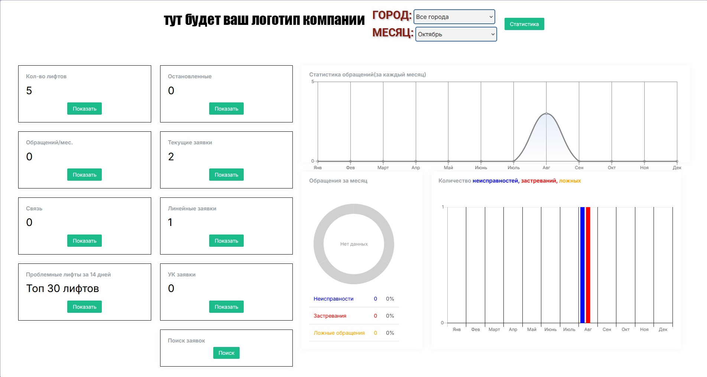

# Веб-интерфейс

Веб-приложение на Flask для просмотра заявок и статистики лифтовой службы. Работает с теми же данными, что и десктопное приложение [elevator_desktop](https://github.com/Ramz4n/elevator_desktop) (журнал заявок), и только читает их. Вход — по логину и паролю из отдельной базы `site`.




## Возможности

- вход по логину и паролю: не больше 5 попыток в минуту и 20 в час с одного IP (`Flask-Limiter`), одинаковый ответ при неверном логине и неверном пароле, сессия 12 часов с последнего действия;
- таблицы заявок, поиск, паспорт объекта;
- статистика: текущие, остановки, линейные, обращения, связь, по УК, топ проблемных лифтов, количество лифтов;
- аналитика по городам и карточка лифта: неисправности, часы простоя, повторные отказы, механики и история заявок;
- кэширование (годовая статистика, memcached).

## Требования

- Windows;
- Python 3.11;
- MariaDB с базами журнала (`vostok_db`) и сайта (`site`) — их создаёт десктопное приложение mitol;
- memcached на `localhost` (используется через `pymemcache`);
- nginx перед сайтом (HTTPS, сертификат Let's Encrypt через win-acme).

## Установка

```powershell
python -m venv .venv
.venv\Scripts\activate
pip install -r requirements.txt
copy .env.example .env
```

Заполните `.env` (шаблон — `.env.example`):

| Переменная | Значение |
| --- | --- |
| `DB_HOST`, `DB_PORT` | адрес и порт MariaDB |
| `DB_NAME_SITE` | база с пользователями сайта (`site`) |
| `DB_NAME_JOURNAL` | база журнала заявок (`vostok_db`) |
| `DB_TABLE` | таблица заявок (`zayavki`) |
| `DB_USER`, `DB_PASSWORD` | пользователь MariaDB для сайта (см. ниже) |
| `SECRET_KEY` | секрет Flask, сгенерировать: `python -c "import secrets; print(secrets.token_hex(32))"` |
| `HOST` | адрес, на котором слушает сайт (порт 8080); за nginx на том же ПК — `127.0.0.1` |
| `HTTPS` | `true`, если сайт открывается по HTTPS: cookie входа передаются только по HTTPS |

Файл `.env` в git не попадает и не должен попадать. Сохраните его копию вручную в надёжное место (менеджер паролей, флешка): в бэкапы он не входит, потому что содержит `SECRET_KEY` и пароль от базы.

Пакеты ставятся в тот Python, которым запускается сайт. Если `.venv` нет, это Python, указанный в задаче `FlaskTesterApp` (`taskschd.msc` → задача → «Действия»), например:

```
"C:\Users\Server\AppData\Local\Programs\Python\Python311\python.exe" -m pip install -r requirements.txt
```

## Пользователь БД для сайта

Сайту нужен отдельный пользователь MariaDB только с правом чтения. Создайте его скриптом:

```
create_db_user.bat
```

Скрипт спросит логин и пароль администратора MariaDB (нигде их не сохраняет), создаст пользователя `site_xxxxxxxx` со случайным паролем, выдаст `SELECT` на `DB_NAME_SITE` и `DB_NAME_JOURNAL` и запишет `DB_USER` и `DB_PASSWORD` в `.env`. Если сайт подключается не с того же ПК, где стоит БД, скрипт спросит, с какого хоста разрешить подключение. После этого перезапустите сайт.

## Пользователи сайта

Логины и пароли для входа на сайт добавляются в десктопном приложении: меню «Добавить» → «Добавить пользователя на сайт» (нужен администратор MariaDB). Пароли хранятся только в виде хэша.

## Запуск

Вручную:

```powershell
python tester.py
```

Сайт откроется на `http://<HOST>:8080` (сервер `waitress`).

Постоянная работа на Windows:

- `install_task.bat` (от имени администратора) создаёт задачи планировщика:
  - `FlaskTesterApp` — при входе в Windows запускает `watchdog.py`, который держит сервер запущенным и перезапускает его через 5 секунд после падения. Без лимита времени работы;
  - `backup` — запускает `backup.bat` каждый час (частота — `BACKUP_EVERY_HOURS` в начале `install_task.bat`).

  Повторный запуск заменяет задачи, а не создаёт дубли. Чтобы сайт поднимался после перезагрузки без ручного входа, в Windows должен быть включён автовход (`netplwiz`).
- `restart.bat` перезапускает сервер (watchdog поднимет его заново; если watchdog не работает — запустит задачу `FlaskTesterApp`);
- лог пишется в `app.log`.

nginx и win-acme в `install_task.bat` не входят: у них свои задачи (`Nginx Autostart`, `win-acme renew`). У задачи nginx в настройках должен быть снят лимит «Остановить задачу, если она выполняется дольше 3 дней».

## Работа за nginx

Сайт слушает `127.0.0.1:8080`, снаружи к нему обращаются только через nginx по HTTPS. В `.env`: `HOST=127.0.0.1`, `HTTPS=true`.

В `nginx.conf` в блоке `server` вашего домена:

```nginx
location / {
    proxy_pass http://127.0.0.1:8080;
    proxy_set_header Host $host;
    proxy_set_header X-Real-IP $remote_addr;
    proxy_set_header X-Forwarded-For $proxy_add_x_forwarded_for;
    proxy_set_header X-Forwarded-Proto $scheme;
}
```

Заголовки `X-Forwarded-*` обязательны: по ним сайт узнаёт настоящий IP посетителя (`ProxyFix` в `tester.py`). Без них лимит попыток входа будет общим на всех. В конфиге не должно быть `root`, указывающего на папку проекта, — иначе nginx отдаст `.env`.

Обновление nginx на Windows: скачать новую версию с nginx.org, в cmd от имени администратора остановить nginx (`nginx -s quit` или `taskkill /f /im nginx.exe`), заменить `nginx.exe` (папку `conf` не трогать), проверить `nginx -t` и `nginx -v`, запустить `start nginx`. Если переименовываете папку nginx, поправьте пути в задачах `Nginx Autostart` и `win-acme renew`.

## Бэкап

`backup.bat` делает дамп баз `DB_NAME_JOURNAL` и `DB_NAME_SITE`, проверяет его и сохраняет в zip. Логин и пароль берутся из `DB_USER` и `DB_PASSWORD` в `.env` (хватает права `SELECT`; если в базе есть триггеры или представления, нужны ещё `TRIGGER` и `SHOW VIEW`).

Хранение:

- на компьютере (`D:\backup`) — все бэкапы за 14 дней;
- в Google Drive — первый удачный бэкап каждого дня, 30 дней.

Настройки — в начале `backup.ps1`: путь к `mysqldump.exe`, папки, сроки хранения (`$LocalKeepDays`, `$GDriveKeepDays`).

Google Drive: на сервере должна быть установлена программа «Google Drive для компьютера» с входом в аккаунт. Скрипт только копирует архив в папку `$GDriveDir` (по умолчанию `G:\Мой диск\backup`), в облако её загружает сама программа. Если диска Google Drive нет, бэкап сохраняется только локально, ошибка пишется в лог.

Дамп не сохраняется, если:

- `mysqldump` завершился с ошибкой или файл пустой;
- дамп оборван (нет строки `-- Dump completed`);
- в основной таблице нет данных (`DB_TABLE` для журнала, `users` для сайта);
- дамп меньше половины прошлого — похоже, из базы пропали данные.

В этом случае рядом с бэкапами (и в Google Drive) появляется файл `ВНИМАНИЕ_бэкап_<база>_не_сохранён.txt` с причиной, а задача `backup` завершается с ошибкой. Старые хорошие копии при сбоях не удаляются. Если данные удалили намеренно, один раз запустите `backup.bat -Force`.

Лог: `D:\backup\backup.log`.

Восстановление из бэкапа:

1. Распакуйте нужный архив, например `vostok_db_2026-11-04_03-00.zip`.
2. Остановите сайт или предупредите пользователей.
3. Загрузите дамп от имени администратора MariaDB:

   ```
   D:\mariadb\bin\mysql -u root -p vostok_db < vostok_db_2026-11-04_03-00.sql
   ```

   Дамп перезаписывает таблицы целиком: всё, что было внесено после времени бэкапа, пропадёт. Если нужна только часть данных, восстановите дамп во временную базу (`CREATE DATABASE restore_tmp;` и загрузите в неё) и перенесите нужное вручную.

## Если что-то не работает

| Признак | Что проверить |
| --- | --- |
| nginx отдаёт 502 Bad Gateway | сайт не запущен: последние строки `app.log` (`powershell -command "Get-Content app.log -Tail 20 -Encoding UTF8"`); `ModuleNotFoundError` — пакеты не установлены в Python задачи `FlaskTesterApp` (см. «Установка») |
| `curl -I http://127.0.0.1:8080/login` даёт 200, а по домену не открывается | nginx не запущен: `tasklist \| findstr nginx`, запустить `start nginx` из его папки, ошибки — в `logs\error.log` nginx |
| `nginx -s quit`: `Access is denied` | cmd запущен не от имени администратора |
| «Слишком много попыток входа» у всех сразу | в nginx нет заголовка `X-Forwarded-For` |
| после перезагрузки сайт не поднялся | выключен автовход в Windows или задача `FlaskTesterApp` отключена (`taskschd.msc`) |
| нет свежих бэкапов | `D:\backup\backup.log` и файл `ВНИМАНИЕ_...txt` в папке бэкапов |

## Структура

| Файл | Назначение |
| --- | --- |
| `tester.py` | приложение Flask, маршруты |
| `db_manager.py` | подключение к MariaDB (пул соединений) |
| `yearly_stats_cache.py` | кэш годовой статистики |
| `watchdog.py` | автоперезапуск сервера |
| `install_task.bat`, `install_task.ps1` | создание задач `FlaskTesterApp` и `backup` в планировщике |
| `restart.bat` | перезапуск сервера |
| `backup.bat`, `backup.ps1` | бэкап баз с проверкой и копированием в Google Drive |
| `create_db_user.py`, `create_db_user.bat` | создание пользователя БД для сайта |
| `templates/` | HTML-шаблоны |
| `static/css/theme.css` | общие цвета и шрифты сайта |
| `static/css/tables.css` | общие стили страниц со списками |
| `static/` | изображения и остальная статика |
