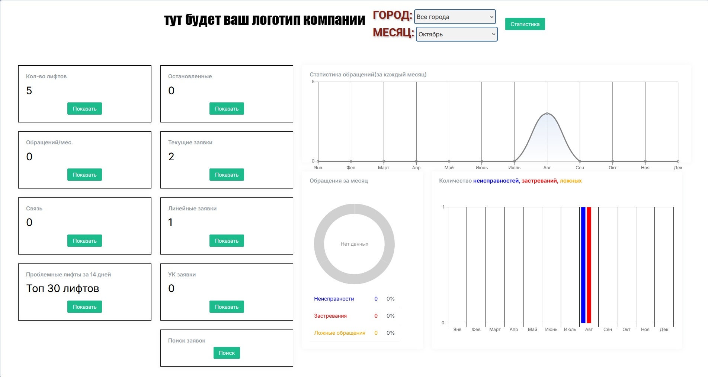

# Веб-интерфейс

Веб-приложение на Flask для просмотра заявок и статистики лифтовой службы. Работает с теми же данными, что и десктопное приложение [elevator_desktop](https://github.com/Ramz4n/elevator_desktop) (журнал заявок), и только читает их. Вход — по логину и паролю из отдельной базы `site`.




## Возможности

- вход по логину и паролю, ограничение по IP (`flask-ipban`);
- таблицы заявок, поиск, паспорт объекта;
- статистика: текущие, остановки, линейные, обращения, связь, по УК, топ проблемных лифтов, количество лифтов;
- кэширование (годовая статистика, memcached).

## Требования

- Windows;
- Python 3.11;
- MariaDB с базами журнала (`vostok_db`) и сайта (`site`) — их создаёт десктопное приложение mitol;
- memcached на `localhost` (используется через `pymemcache`).

## Установка

```powershell
python -m venv .venv
.venv\Scripts\activate
pip install -r requirements.txt
copy .env.example .env
```

Заполните `.env` (шаблон — `.env.example`):

| Переменная | Значение |
| --- | --- |
| `DB_HOST`, `DB_PORT` | адрес и порт MariaDB |
| `DB_NAME_SITE` | база с пользователями сайта (`site`) |
| `DB_NAME_JOURNAL` | база журнала заявок (`vostok_db`) |
| `DB_TABLE` | таблица заявок (`zayavki`) |
| `DB_USER`, `DB_PASSWORD` | пользователь MariaDB для сайта (см. ниже) |
| `SECRET_KEY` | секрет Flask, сгенерировать: `python -c "import secrets; print(secrets.token_hex(32))"` |
| `HOST` | адрес, на котором слушает сайт (порт 8080) |

Файл `.env` в git не попадает и не должен попадать.

## Пользователь БД для сайта

Сайту нужен отдельный пользователь MariaDB только с правом чтения. Создайте его скриптом:

```
create_db_user.bat
```

Скрипт спросит логин и пароль администратора MariaDB (нигде их не сохраняет), создаст пользователя `site_xxxxxxxx` со случайным паролем, выдаст `SELECT` на `DB_NAME_SITE` и `DB_NAME_JOURNAL` и запишет `DB_USER` и `DB_PASSWORD` в `.env`. Если сайт подключается не с того же ПК, где стоит БД, скрипт спросит, с какого хоста разрешить подключение. После этого перезапустите сайт.

## Пользователи сайта

Логины и пароли для входа на сайт добавляются в десктопном приложении: меню «Добавить» → «Добавить пользователя на сайт» (нужен администратор MariaDB). Пароли хранятся только в виде хэша.

## Запуск

Вручную:

```powershell
python tester.py
```

Сайт откроется на `http://<HOST>:8080` (сервер `waitress`).

Постоянная работа на Windows:

- `install_task.bat` (от имени администратора) создаёт задачу планировщика `FlaskTesterApp`: при входе в Windows запускается `watchdog.py`, который держит сервер запущенным и перезапускает его через 5 секунд после падения;
- `restart.bat` перезапускает сервер (watchdog поднимет его заново);
- лог пишется в `app.log`.

## Структура

| Файл | Назначение |
| --- | --- |
| `tester.py` | приложение Flask, маршруты |
| `db_manager.py` | подключение к MariaDB (пул соединений) |
| `yearly_stats_cache.py` | кэш годовой статистики |
| `watchdog.py` | автоперезапуск сервера |
| `create_db_user.py`, `create_db_user.bat` | создание пользователя БД для сайта |
| `templates/` | HTML-шаблоны |
| `static/` | изображения и статика |
